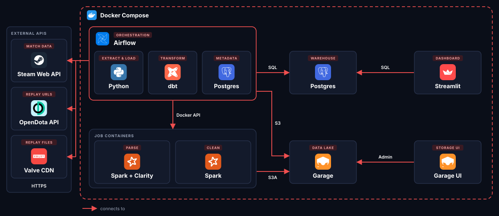

# dota-pipeline

An end-to-end data pipeline for Dota 2. It samples ranked matches from the Steam Web API, downloads
and parses their replays into event-level tables, models them in a Postgres warehouse with dbt, and
serves the results in a Streamlit dashboard. Everything runs locally under Docker Compose and is
orchestrated by Airflow.



## How it works

1. **Sample matches.** `steam_fetch` saves pages of recent matches from the Steam Web API to Garage
   every hour. `steam_summary_elt` loads them into the warehouse (`stg.steam_*`).
2. **Queue replays.** Every day at 01:00 SGT, `dota_daily_download` picks 50 of yesterday's ranked
   All Pick matches and puts them in the download queue (`ingest.download_queue`).
3. **Download.** `download_pending` gets each replay URL from OpenDota and saves the `.dem` file
   from Valve's CDN to Garage. Replays that aren't available yet are retried every hour.
4. **Parse.** `parse_pending` runs the replay parser (Spark plus the Java Clarity extractor) on
   each new replay and writes one Parquet table per event type.
5. **Clean.** `clean_pending` runs the Spark clean job and checks the output against the clean
   contract.
6. **Load.** `load_pending` loads the clean Parquet into the warehouse (`clean.*`).
7. **Model.** `dbt_build` builds the marts from `clean.*`, `stg.steam_*` and the reference dims.
8. **Serve.** The Streamlit dashboard reads the marts.

Each stage triggers the next through Airflow Assets, so new data flows through without waiting on
timers. Every step is safe to re-run.

## Tech stack

| Layer | Technology |
|---|---|
| Orchestration | Apache Airflow 3 |
| Ingestion | Python (requests, boto3, psycopg2) |
| Replay parsing and cleaning | PySpark, Java 21, [Clarity](https://github.com/skadistats/clarity) |
| Data lake | Garage (S3-compatible object store) |
| Warehouse | PostgreSQL 16 |
| Transformation | dbt (dbt-postgres; dbt-duckdb for local tests) |
| Dashboard | Streamlit, Plotly |
| Runtime | Docker Compose |

## Quick start

You need Docker Desktop and a [Steam Web API key](https://steamcommunity.com/dev/apikey).

1. Create `.env` in the repo root. See `.env.example`.
   ```
   STEAM_API_KEY=your-key
   AIRFLOW_FERNET_KEY=generated-key
   ```
   Generate the Fernet key with:
   ```
   python -c "import base64,os; print(base64.urlsafe_b64encode(os.urandom(32)).decode())"
   ```
2. Build the two job images, then start the stack:
   ```
   docker build -t dota-parser -f parser/Dockerfile .
   docker build -t dota-spark-clean -f spark_jobs/Dockerfile .
   docker compose up -d --build --remove-orphans
   ```
3. In the Airflow UI, unpause `steam_fetch` and the other DAGs.

| Service | URL |
|---|---|
| Airflow | http://localhost:8080 |
| Dashboard | http://localhost:8501 |
| Garage browser | http://localhost:3909 |
| Warehouse (psql, notebooks) | `localhost:5433` |

The full setup, upgrade notes and Airflow Variables are in
[CONTRIBUTING.md](CONTRIBUTING.md#running-locally).

## DAGs

| DAG | Schedule | What it does |
|---|---|---|
| `steam_fetch` | Hourly | Save the newest Steam match pages to Garage |
| `steam_summary_elt` | On new pages | Load the pages into `stg.steam_*` |
| `dota_daily_download` | Daily 01:00 SGT | Pick yesterday's matches and queue their replays |
| `download_pending` | Hourly, and on new picks | Download the queued replays to Garage |
| `parse_pending` | Hourly | Parse new replays into Parquet tables |
| `clean_pending` | On new parsed output | Clean the parsed tables and check the contract |
| `load_pending` | On new clean output | Load the clean tables into Postgres |
| `dbt_build` | On new loads | Build the dbt marts |
| `refresh_constants` | Daily (starts paused) | Update heroes, items, patches and game modes |
| `replay_parse` | Manual | Parse one replay by `match_id` |

## Dashboard

- **Hero statistics:** pick rate against win rate, matchups, allies, win rate by game length and
  item timings.
- **Match analysis:** scoreboard, net-worth lead, kill timeline, an animated map replay, fights,
  laning, item builds and damage.
- **Replay insights:** trends across all parsed replays, such as how often an early lead holds and
  what lands the killing blow.

See [dashboard/README.md](dashboard/README.md).

## Repository layout

```
dags/          Airflow DAGs (orchestration only); the logic lives in dags/dota/
parser/        Java replay extractor (Clarity); Dockerfile builds the dota-parser image
spark_jobs/    PySpark parse and clean jobs
dbt/           dbt project: staging, dims and marts
warehouse/     Postgres DDL and a fixture match for local tests
dashboard/     Streamlit app
airflow/       Airflow image
garage/        Garage image
downloader/    Standalone downloader that saves to Google Drive (used before the pipeline existed)
scripts/       Manual tools (checks, reconciliation, metrics)
notebooks/     Exploration notebooks
tests/         pytest suite
docs/          Data contracts and lane docs
```

## Tests

```
pytest
```

Python tests need no network, Docker or API keys. To test dbt models locally on DuckDB, see
[CONTRIBUTING.md, rule 10](CONTRIBUTING.md#10-database-and-dbt-owner-chris).

## Documentation

- [Data contract](docs/data-contract.md): raw layer, table by table
- [Clean contract](docs/clean-contract.md): clean tables and marts, with grain and keys
- [Steam lane](docs/steam-lane.md) and [constants lane](docs/constants-lane.md)
- [CONTRIBUTING.md](CONTRIBUTING.md): setup, rules, ownership and the git workflow
