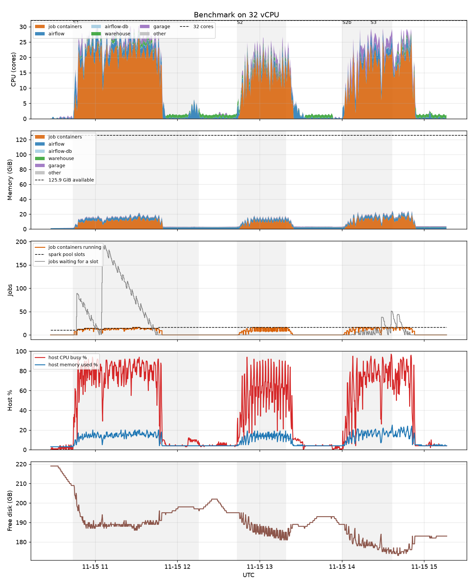
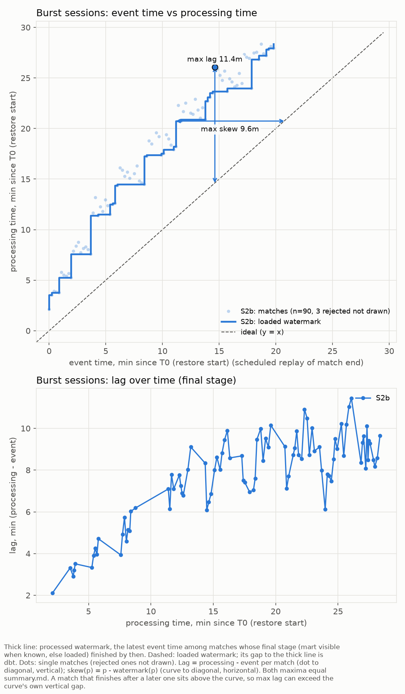

# Results

Benchmark of 15 November 2026. Setup and method are in [README.md](README.md). Laptop: 66 real matches in one burst (03:27–04:43 UTC). VM: 645 real matches parsed over four sessions (10:44–15:17 UTC).

## Throughput

| | Laptop | VM (32 vCPU) |
|---|---|---|
| Throughput ceiling μ (matches loaded per minute) | ~1.0 | **5.49** (147 loads in 26.8 min at 16 slots) |
| Per day at μ | ~1,400 | **~7,900** |
| Limiting resource | **Memory:** peak 5.4 of 7.65 GiB, ~6 of 10 cores busy | **CPU:** peak 94–97%, average 55–65% under load; memory under 20% |
| Run time per match, p50 / p95 | parse 51 s, clean 50 s, load 5 s (p50) | parse 93 / 127 s, clean 89 / 120 s, load 4 / 11 s |

The bottleneck moves with the machine:
- **Laptop:** memory allows only two 2 GiB containers, while cores sit idle.
- **VM:** CPU saturates at about 16 parallel jobs, about two cores per job. The auto-tuner reached 91% CPU at 14–16 slots and backed off; memory never came close.

Per-match times are higher on the VM because 16 jobs share the cores, but throughput is about 5.5× the laptop's.

At about 7,900 matches a day per VM, the proposal's 100,000 a day would take about 13 such machines for parse and clean, which scale horizontally. The warehouse stage would need redesigning first (see dbt below).

## Latency

| Session | Arrivals | Matches | Parsed p50 / p95 | Cleaned p50 / p95 | Loaded p50 / p95 | Max skew |
|---|---|---|---|---|---|---|
| S2b, below capacity | 4.65/min (≈0.85 μ) | 93 | 3.4 / 4.9 min | 7.3 / 9.3 min | **8.1 / 10.2 min** | 9.6 min |
| S3, overload | 7.67/min (≈1.4 μ) | 115 | 7.0 / 16.5 min | 13.0 / 21.3 min | 10.6 / 39.3 min* | 36 min |
| S1, burst | 300 at once | 300 | 29 / 57 min | 34 / 60 min | 66 / 90 min | 1.5 h |
| Laptop burst | 2/min (≈2 μ) | 66 | 12.3 / 32.8 min | – | 14.1 / 38.6 min | 47 min |

\* Only 36 of S3's 111 cleaned matches had loaded when the data was extracted; the rest were waiting behind a dbt build.

- **Below capacity (S2b):** lag stays flat, and every match is loaded within about 10 minutes of arriving.
- **Above capacity (S3, laptop):** the backlog and lag grow linearly for as long as the overload lasts, then drain at μ.
- **S1** is the extreme case: 300 matches cleared in 91 minutes.

Per-session tables: `data/S1.md`, `data/S2b.md`, `data/S3.md`.

## Data quality

- **Clean:** 619 of 645 parsed matches passed (96.0%). The 26 rejected are held for review and never partially loaded.
- **Parse:** no failures.
- **S1 rejection reasons:** 9 × "combatlog: unresolved hero victim" and 1 × "Credit search limit exceeded".
- **Laptop check** of the same clean job on 66 real matches: 65 passed.

## dbt became the bottleneck

`dbt_build` runs after every load and holds the single `warehouse_write` slot, which loads also need. On `master` it rebuilds every mart and runs every test over all matches, so it gets slower as the warehouse grows:

| Run started (UTC) | 10:48 | 10:52 | 10:58 | 11:05 | 11:18 | 11:42 | 12:07 | 13:32 (patched) | 14:37 (patched) |
|---|---|---|---|---|---|---|---|---|---|
| Duration | 1:53 | 2:26 | 7:15 | 12:31 | 24:13 | 24:56 | 35:30 | 20:15 | 26:06 |

On the laptop, with about 60 matches, a build takes about 2 minutes. On the VM, at about 300 matches, one build held the write slot for 36 minutes and blocked every load. That is why the first S2 was aborted.

**Diagnosis:** per-node timings showed five data tests on the replay observation grid taking about 23 of a 28-minute build. The grid was a view, so each test recomputed it for every match.

**The patch on this branch:** it makes the grid and `team_advantage_timeline` incremental by `match_id`, and cut the next build from 36 to 20 minutes. Build time still grows with data (26 minutes after S3), for two reasons:
- the remaining marts are full-table builds;
- one independent reference test deliberately recomputes the grid from raw stats.

**Next steps:**
- make the other per-match marts incremental;
- run heavy reference tests nightly instead of after every load;
- trigger dbt on a timer instead of per load, so loads never wait behind a build.

Full timings: `data/dbt_runs.csv`.

## Scale

On the VM the warehouse reached 619 matches and 8.1 GB:
- 12.8 million player-statistics rows;
- 12.1 million position rows;
- 10.2 million damage events.

That is about 20,000 statistics rows and 13 MB per match, against 8–34 MB for the raw replay. The laptop warehouse (67 replay matches, 15,949 Steam matches) is 1.1 GB.

## Data in this folder

- `data/sessions.csv`: session windows.
- `data/dbt_runs.csv`: every dbt build, with its duration.
- `data/autotune.csv`: every auto-tuner decision.
- `data/S1.md`, `data/S2b.md`, `data/S3.md`: per-stage latency.

The raw 15-second samples, per-container stats and every Airflow task instance are archived separately; they are too large for git.
